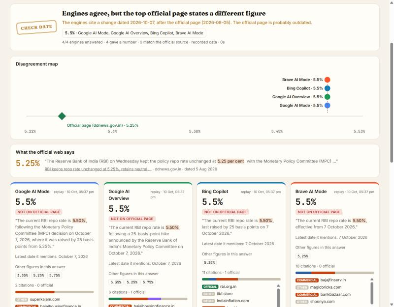
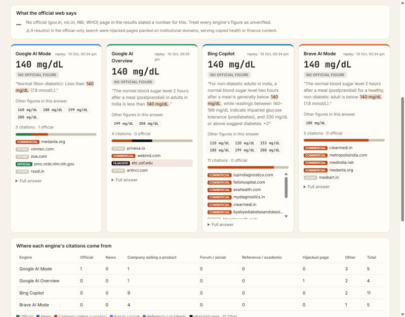
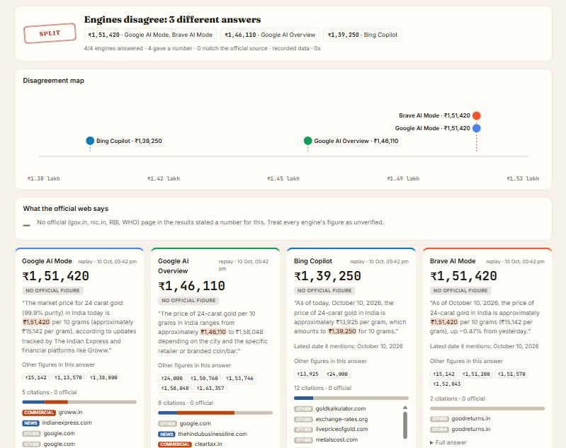
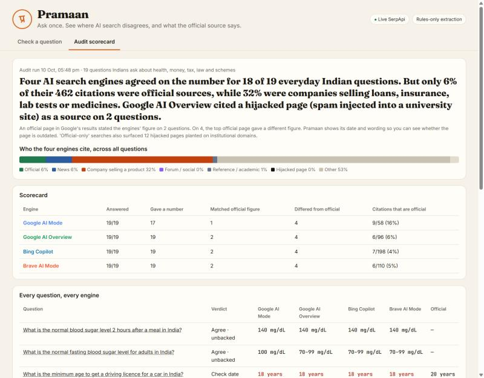

# Pramaan · प्रमाण

**Ask once. See where AI search disagrees, who it's quoting, and what the official page says.**

Indians now get numbers that matter (blood-sugar limits, interest rates, fines, tax limits, prices) from AI answers at the top of search. Pramaan asks **four AI search engines the same question at the same moment** through SerpApi: Google AI Mode, Google AI Overview, Bing Copilot and Brave AI Mode. It then:

1. pulls out the number each engine gives, with the exact sentence it said it in;
2. checks whether the engines agree with each other;
3. sets that number against **official Indian pages** (gov.in, nic.in, RBI, WHO), **with their dates**, so a stale page or a stale answer is visible;
4. shows **who each engine is quoting**: official bodies, news, companies selling the product, forums, or hijacked pages.

> SerpApi India Hackathon 2026 · **Track: Knowledge & Public Interest** (news and information literacy)
> Runs locally · works **with no API key** in replay mode · no AI model at runtime



---

## What we found (19 everyday questions, 4 engines, 10 Oct 2026)

Run `python audit.py` to reproduce. Every response is recorded in [`replay/`](replay/).

**1. Google's AI Overview cited a hijacked university page as a source for Indian blood-sugar limits.**
For both *"normal blood sugar 2 hours after a meal in India"* and *"normal fasting blood sugar for adults in India"*, one of the AI Overview's references was
`etc.usf.edu/clipvr/376-a-panoramic-view-…?xml=data:gsf,<krpano><include url="//…">`.
That is a University of South Florida page whose panorama viewer (krpano) has been abused to inject content from a spam host. A search restricted to *official* domains surfaced **12 more** such pages planted on an Indian institute's domain (`nsit.in`), all serving copied health advice. Pramaan labels them `hijacked` and never counts them as official.



**2. The engines agree, but rarely on official authority.**
The four engines gave the same figure on **18 of 19** questions. Yet only **28 of 462 citations (6%)** were official sources. **149 (32%)** were companies that sell the thing being asked about: loan marketplaces, insurers, hospitals and diagnostic labs.

**3. The top official page Google ranks is often the stale one.** On 4 questions the highest-ranked official page stated a different figure from all four engines. We checked each by hand:

| Question | Engines | Top official page | Who is right |
|---|---|---|---|
| Current RBI repo rate | 5.5% (citing the hike on 7 Oct 2026) | 5.25%, DD News, **5 Aug 2026** | Engines. Pramaan flags it from the dates alone: *"The official page is probably outdated."* |
| First-offence drunk-driving fine | ₹10,000 | ₹2,000, a district police site | Engines. The police page quotes the law from before the 2019 amendment |
| GST on restaurant food | 5% | 12%, a government MSME page | Engines. The page is the 2017 rate list |
| Minimum age for a car licence | 18 years | 20 years, a state transport site | Both. The 20-year rule is for *transport* vehicles, which the quote shows |

**4. On live prices, the engines split.** *"Price of 24-carat gold per 10 grams today"*: **₹1,51,420** (Google AI Mode, Brave), **₹1,46,110** (AI Overview), **₹1,39,250** (Bing Copilot). That is an 8% spread on the same day, for a figure people buy jewellery on.





The idea came from reporting by [The Ken](https://the-ken.com/story/ai-cites-a-hospital-for-health-advice-but-the-hospital-uses-ai-to-write-the-advice-and-both-are-wrong/) (2026): Google's AI Overview gave Indians a wrong diabetes threshold that traced back to AI-written hospital SEO pages. Pramaan turns that one-off investigation into a check anyone can run on any question.

---

## How it works

```
question ──┬─ google_ai_mode (gl=in) ──────────┐
           ├─ google (gl=in) → ai_overview ────┤  4 answers: text blocks + references
           │   └─ google_ai_overview (page_token, when the overview loads separately)
           ├─ bing_copilot ────────────────────┤
           ├─ brave_ai_mode (country=in) ──────┘
           └─ google (gl=in, site:gov.in OR site:nic.in OR site:rbi.org.in OR site:who.int)
                                              → official evidence, with dates
   ↓
claims.py   numbers + units (₹, lakh/crore, %, mg/dL, weeks, years…), ranges ("70–100 mg/dL"),
            "per 10 grams" vs "per gram", years-vs-quantities; key claim = first on-topic figure
sources.py  official · news · company selling the product · forum · reference · hijacked (krpano injection)
check.py    group engines by agreement (range-aware) → match against official statements →
            compare dates the engines cite with the official page's date → verdict
```

**Verdicts:** `Backed` (an official page states the engines' figure) · `Agree · unbacked` (no official figure found) · `Check date` (engines agree, the top official page differs; the dates say which is probably stale) · `Split` (the engines disagree).

### Why SerpApi is load-bearing

Remove SerpApi and nothing is left. Each question makes **5–6 SerpApi calls across 5 engines**:

| SerpApi engine | Used for |
|---|---|
| `google_ai_mode` | Google AI Mode answer + references, India locale |
| `google` | Google India results: the AI Overview block and organic results used as evidence |
| `google_ai_overview` | Fetches the AI Overview when Google loads it separately (`page_token`) |
| `bing_copilot` | Bing Copilot answer + references |
| `brave_ai_mode` | Brave AI answer, segment-level citations, India locale |
| `google` with `site:` filters | The official-source yardstick: gov.in, nic.in, RBI, WHO pages, with dates |

Two of these engines (Bing Copilot, Brave AI Mode) were used by no other hackathon entry we could find among ~200 public repos.

### Design choices

- **No AI model at runtime.** Every verdict is deterministic and reproducible from the recorded JSON. An optional Gemini step (`GEMINI_API_KEY`) can *propose* each engine's key figure, but a proposal is used only if its quote appears verbatim in the engine's answer and the number can be read back out of that quote (`llm.verified`). If Gemini is unavailable, the app falls back to rules on its own.
- **Recorder and replay.** Every live SerpApi response is saved to `replay/` (with the API key redacted). Judges can run every recorded question with **no key and zero API calls**, and every number in this README can be traced to a file.
- **Honest wording.** Pramaan never says "true" or "false". It says who agrees, who they quote, and what the official page says and when.

---

## Run it locally

Requires Python 3.10+.

```bash
git clone <this repo> && cd pramaan
pip install -r requirements.txt
python app.py            # open http://127.0.0.1:8000
```

- **Replay mode (no key):** click any sample question, or open the **Audit scorecard** tab. Everything recorded in `replay/` works offline.
- **Live mode:** create a free key at [serpapi.com](https://serpapi.com) (250 searches/month), then `cp .env.example .env` and set `SERPAPI_API_KEY`. Any new question now runs live, about 6 searches each. New responses are recorded automatically.

```bash
python audit.py           # all questions in questions.json → audit/results.json (uses recordings)
python audit.py --fresh   # re-ask everything live
python -m unittest        # 12 tests: units, ranges, per-quantity, dates, verdicts, LLM guard, source kinds
```

### Use it from an AI agent (MCP)

`mcp_server.py` exposes a `cross_check(question)` tool, so an agent can check a number before it states it:

```bash
claude mcp add pramaan -- python /absolute/path/to/pramaan/mcp_server.py
```

It returns the verdict, each engine's figure and quote, the official page and its date, and any hijacked results.

## Project layout

```
app.py            FastAPI app + /api/check, /api/status (OpenAPI docs at /docs)
audit.py          benchmark runner → audit/results.json
mcp_server.py     MCP tool: cross_check(question)
pramaan/serp.py   SerpApi client with recorder/replay and key redaction
pramaan/engines.py adapters for the four answer engines + official search
pramaan/claims.py numeric claim extraction, ranges, units, dates
pramaan/sources.py citation classification, incl. hijacked-page detection
pramaan/check.py  orchestration (parallel calls) and verdict logic
pramaan/llm.py    optional Gemini proposer with verbatim-quote guard
static/           single-page UI (no build step)
questions.json    the 19 benchmark questions
replay/           every recorded SerpApi response (key redacted)
```

## Limitations

- The key figure is the first on-topic number in the expected unit. Answers that open with a caveat number can be misread. The quote is always shown so a reader can see it.
- "Official" means the domain list in `sources.py`. A stale official page is still official, which is why dates are shown.
- Source classes for unknown domains use name hints (hospital, diagnostics, finance…). 53% of citations stay `other`, so the 32% "company" share is a lower bound.
- Bing Copilot has no locale parameter, so its answers are not India-localised the way the others are.
- 19 questions on one day is a snapshot, not a study. `audit.py --fresh` re-runs it any day.

## AI tools used

Built with Claude Code (Anthropic) as a pair programmer for research, code and documentation. All findings above were checked by hand against the recorded responses.

## License

MIT
